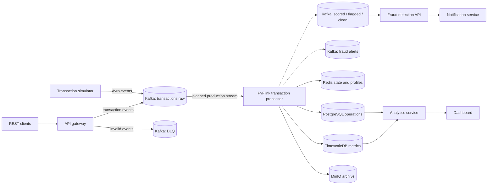

# HERMES

### Real-Time Financial Fraud Detection & Transaction Intelligence

HERMES is an event-driven platform for ingesting financial transactions, evaluating fraud risk, and serving operational and analytical views. It combines Kafka-based event transport, versioned Avro contracts, Python services, a Flink runtime, and purpose-built storage systems.

> **Project status:** The repository includes the multi-service platform, the PyFlink 1.19.3 runtime foundation, and the Schema Registry/Avro boundary work. The production Kafka-to-Flink transaction job is still being developed; a passing runtime smoke test is not an end-to-end transaction processing validation.

## Architecture



The intended processing design is a Kappa-style flow: Kafka is the replayable event log, and Flink is the stateful stream-processing engine. Transaction and decision contracts live in `infrastructure/kafka/schemas/`; Schema Registry assigns IDs used in Confluent Avro wire framing. REST and debug interfaces use JSON where appropriate.

## Services

| Component | Purpose | Local address |
|---|---|---|
| API gateway | Transaction ingestion and API access | `http://localhost:8000` |
| Fraud detection | Fraud scoring and rule/model endpoints | `http://localhost:8001` |
| Analytics service | Analytics query API | `http://localhost:8002` |
| Notification service | Notification and WebSocket service | `http://localhost:8003` |
| Dashboard | Dashboard web endpoint | `http://localhost:3000` |
| Kafka | Event broker (host listener) | `localhost:9092` |
| Schema Registry | Avro schema management | `http://localhost:8081` |
| Flink JobManager | Runtime dashboard | `http://localhost:8082` |
| Grafana | Metrics dashboard | `http://localhost:3001` |
| Jaeger | Distributed tracing UI | `http://localhost:16686` |

The Compose stack also includes Redis, PostgreSQL, TimescaleDB, MinIO, Prometheus, and a TaskManager. Internal containers use Compose service names such as `kafka:9092` and `schema-registry:8081`.

## Quick start

Requirements: Docker Desktop (or Docker Engine) with the Compose plugin. Building the Python/Flink images requires internet access to fetch pinned dependencies and runtime artifacts.

```powershell
Copy-Item .env.example .env
docker compose config --quiet
docker compose up -d --build
docker compose ps
```

Wait for the services to become healthy. Schema registration is a startup prerequisite for the processor and simulator; if it exits unsuccessfully, inspect its log and the Kafka/Registry health before retrying:

```powershell
docker compose logs schema-registration kafka schema-registry
```

To start the simulator profile after the base services are ready:

```powershell
docker compose --profile simulator up -d transaction-simulator
```

For local development overrides:

```powershell
docker compose -f docker-compose.yml -f docker-compose.dev.yml up -d --build
```

Stop containers while retaining named data volumes:

```powershell
docker compose down
```

Avoid `docker compose down -v` unless you intend to remove local Kafka, database, and other persisted data.

## API quick check

The API gateway exposes health, readiness, and metrics endpoints. See [`docs/api-reference.md`](docs/api-reference.md) for authentication and request details.

```powershell
Invoke-RestMethod http://localhost:8000/health
Invoke-RestMethod http://localhost:8000/readiness
```

The fraud detection API is available at `http://localhost:8001`; analytics and notification services use ports 8002 and 8003 respectively.

## Development and tests

Create the service environments using the manifests under each service directory. Unit and integration tests can be run with:

```powershell
python -m pytest services/transaction-simulator/tests -v
python -m pytest services/transaction-processor/tests -v
python -m pytest tests/integration -v
```

The Makefile also provides `make test`, `make test-integration`, and `make flink-smoke` targets. The Flink smoke test checks the runtime and connector and submits a bounded job; it does not validate the production transaction topology.

## Repository map

```text
infrastructure/       Kafka topics and schemas, Flink runtime configuration
services/             API gateway, processor, simulator, scoring, analytics, notifications
ml/                   Model and feature tooling
tests/integration/    Cross-service and infrastructure integration tests
docs/                 Architecture and API references
docker-compose.yml     Local multi-service stack
implementation_plan.md Project implementation plan
```

For the detailed design and canonical data contracts, see [`docs/architecture.md`](docs/architecture.md) and the Avro schemas in `infrastructure/kafka/schemas/`.

## Configuration and data

`.env.example` contains local development defaults. The Compose network uses internal service hostnames; host-side tools use the published localhost ports. Change development credentials before using the stack beyond a local environment.

Kafka and database data are stored in named Docker volumes. Removing containers with `docker compose down` keeps that data; removing volumes deletes it.

## License

No license file is currently present in this repository. Contact the project maintainers before redistributing the code.
