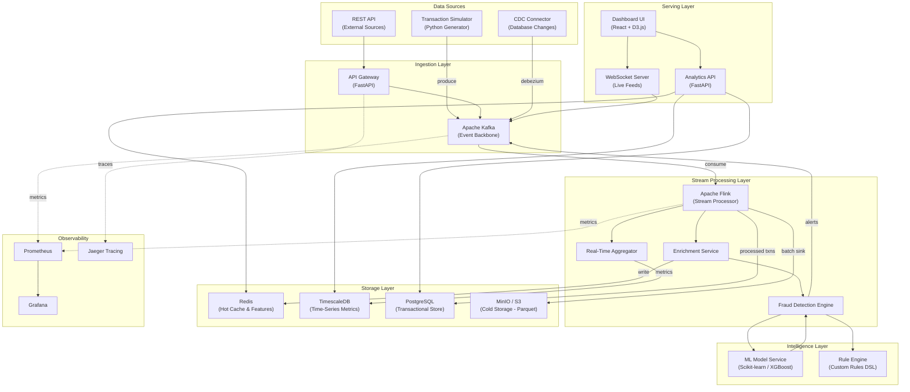
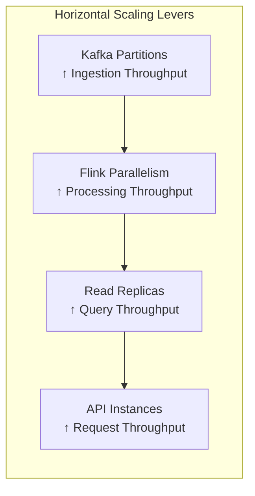
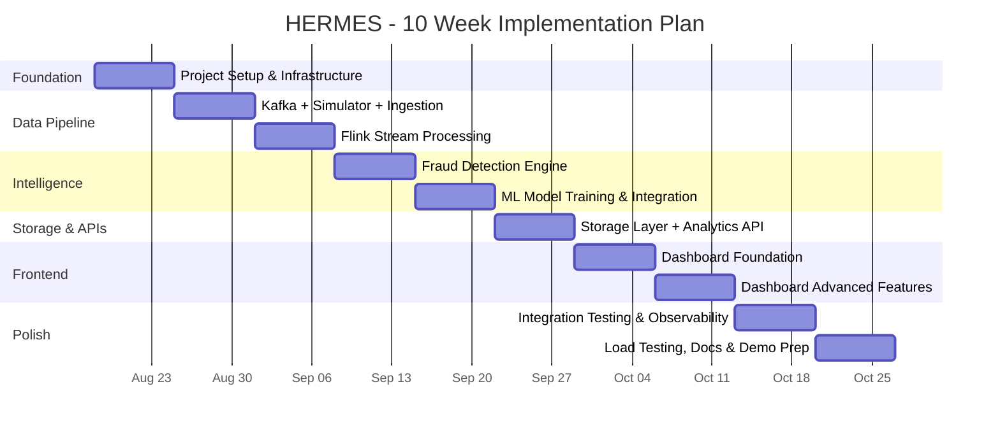

# HERMES — Real-Time Financial Fraud Detection & Transaction Intelligence Platform

> **Project Name:** `HERMES` (Real-Time Financial Fraud Detection & Transaction Intelligence Platform)
> **Timeline:** 10 Weeks (Aug 18, 2026 → Oct 26, 2026)
> **Team:** Full team allocation

---

## 1. Project Vision & Overview

**HERMES** is a real-time Financial Fraud Detection & Transaction Intelligence Platform that ingests, processes, enriches, and analyzes financial transactions at scale. It provides:

- **Real-time fraud detection** with sub-second latency
- **Transaction analytics dashboards** with live streaming metrics
- **Anomaly detection** using ML models on transaction patterns
- **Regulatory compliance monitoring** (AML/KYC pattern detection)
- **Customer spending intelligence** with behavioral segmentation

The platform follows an **event-driven, microservices architecture** built on the **Kappa Architecture** pattern — unifying real-time and historical processing through a single streaming pipeline.

---

## 2. Functional Requirements

### 2.1 Core Features

| # | Feature | Description | Priority |
|---|---------|-------------|----------|
| F1 | **Transaction Ingestion** | Accept transactions from multiple sources (REST API, file uploads, simulated POS/mobile streams) at 10K+ TPS | P0 |
| F2 | **Real-Time Stream Processing** | Enrich, transform, and route transactions through a streaming pipeline with <500ms end-to-end latency | P0 |
| F3 | **Fraud Detection Engine** | Rule-based + ML-based fraud scoring on every transaction in real time | P0 |
| F4 | **Analytics Dashboard** | Live-updating dashboard showing transaction volumes, fraud rates, geographic heatmaps, and spending trends | P0 |
| F5 | **Alerting & Notifications** | Real-time alerts for flagged transactions via WebSocket push and email notifications | P1 |
| F6 | **Customer Intelligence** | Behavioral segmentation, spending pattern analysis, and customer risk profiling | P1 |
| F7 | **Historical Analytics** | OLAP queries over historical transaction data for trend analysis and reporting | P1 |
| F8 | **AML/Compliance Module** | Pattern detection for money laundering indicators (structuring, layering, rapid movement) | P2 |
| F9 | **Transaction Simulator** | Configurable data generator that produces realistic synthetic transaction streams for testing | P0 |
| F10 | **API Gateway** | Unified API layer with rate limiting, authentication, and request routing | P0 |

### 2.2 Non-Functional Requirements

| # | Requirement | Target |
|---|------------|--------|
| NF1 | **Throughput** | ≥ 10,000 transactions/second sustained ingestion |
| NF2 | **Latency** | < 500ms end-to-end (ingestion → fraud score → dashboard) |
| NF3 | **Availability** | 99.9% uptime (via replication & failover) |
| NF4 | **Scalability** | Horizontal scaling — linearly scale with added Kafka partitions and Flink parallelism |
| NF5 | **Data Retention** | Hot: 7 days (Redis/TimescaleDB), Warm: 90 days (PostgreSQL), Cold: unlimited (Object Storage/Parquet) |
| NF6 | **Security** | JWT-based auth, TLS everywhere, PII encryption at rest, role-based access control |
| NF7 | **Observability** | Distributed tracing, centralized logging, health dashboards, SLA alerts |

---

## 3. System Architecture

### 3.1 High-Level Architecture Diagram



### 3.2 Architecture Layers Explained

#### Layer 1: Ingestion
- **API Gateway (FastAPI):** Accepts external transaction submissions, validates schema, authenticates requests, and produces to Kafka
- **Apache Kafka:** The central event backbone — all transactions flow through Kafka topics. Provides durability, replay capability, and decoupling
- **Transaction Simulator:** Python-based generator producing realistic synthetic transactions with configurable fraud injection rates

#### Layer 2: Stream Processing
- **Apache Flink:** The core processing engine performing:
  - **Enrichment:** Joins transaction events with customer profile data, merchant data, and geolocation
  - **Windowed Aggregations:** Sliding-window computations (1min, 5min, 1hr) for velocity checks and volume metrics
  - **Fraud Scoring:** Orchestrates rule engine + ML model invocations for each transaction
  - **Routing:** Splits the stream into clean vs. flagged transactions

#### Layer 3: Intelligence
- **Rule Engine:** Configurable rules (velocity limits, amount thresholds, geo-impossibility checks, blocked merchants)
- **ML Model Service:** Pre-trained XGBoost/Random Forest model served via a lightweight FastAPI service. Accepts feature vectors and returns fraud probability scores

#### Layer 4: Storage (Polyglot Persistence)
| Store | Purpose | Data |
|-------|---------|------|
| **Redis** | Hot cache, feature store, session state | Customer profiles, recent transaction features, fraud flags |
| **TimescaleDB** | Time-series metrics & real-time aggregates | Transaction volumes, fraud rates, latency percentiles |
| **PostgreSQL** | Transactional store & queryable history | Processed transactions, alerts, customer records |
| **MinIO (S3-compatible)** | Cold storage archive | Historical Parquet files for ML training & compliance audits |

#### Layer 5: Serving & Visualization
- **Analytics API (FastAPI):** RESTful endpoints for querying aggregated metrics, historical transactions, and fraud reports
- **WebSocket Server:** Pushes real-time transaction feed and fraud alerts to the dashboard
- **Dashboard (React + D3.js):** Interactive UI with live charts, geographic heatmaps, transaction drilldown, and alert management

#### Layer 6: Observability
- **Prometheus + Grafana:** System metrics, Kafka lag, Flink throughput, API latencies
- **Jaeger:** Distributed tracing across microservices
- **Structured Logging:** JSON-formatted logs aggregated for debugging

### 3.3 Kafka Topic Design

```
hermes.transactions.raw            → Raw ingested transactions
hermes.transactions.enriched       → After enrichment (with customer/merchant data)
hermes.transactions.scored         → After fraud scoring
hermes.transactions.flagged        → Transactions flagged as suspicious
hermes.transactions.clean          → Transactions cleared
hermes.alerts.fraud                → Fraud alert events
hermes.metrics.realtime            → Aggregated metrics for dashboards
hermes.dlq                         → Dead letter queue for failed processing
```

---

## 4. Technology Stack

### 4.1 Complete Stack Summary

| Layer | Technology | Version | Justification |
|-------|-----------|---------|---------------|
| **Language** | Python | 3.11+ | Primary language — team familiarity, rich ML/data ecosystem |
| **API Framework** | FastAPI | 0.110+ | Async, high-perf, auto-docs (OpenAPI), WebSocket support |
| **Event Streaming** | Apache Kafka | 3.7+ | Industry standard for event-driven architectures, high throughput, durable |
| **Stream Processing** | Apache Flink | 1.19+ | Stateful stream processing, exactly-once semantics, windowing, CEP |
| **Flink API** | PyFlink | 1.19+ | Python API for Flink — keeps the stack unified in Python |
| **Hot Cache** | Redis | 7.2+ | Sub-ms reads for feature store, caching, pub/sub |
| **Time-Series DB** | TimescaleDB | 2.14+ | PostgreSQL extension — SQL-native time-series with automatic partitioning |
| **Relational DB** | PostgreSQL | 16+ | ACID compliance, rich querying, mature ecosystem |
| **Cold Storage** | MinIO | Latest | S3-compatible object storage, self-hosted, stores Parquet archives |
| **ML Framework** | Scikit-learn / XGBoost | Latest | Lightweight, fast training & inference for tabular fraud detection |
| **Dashboard UI** | React 18 + D3.js | Latest | Component-based UI with powerful data visualization |
| **Charting** | Recharts + D3.js | Latest | React-native charts + custom D3 for heatmaps and complex viz |
| **Containerization** | Docker + Docker Compose | Latest | Unified local dev environment, easy onboarding |
| **Orchestration** | Kubernetes (optional) | 1.29+ | Production-grade orchestration (stretch goal for Week 9-10) |
| **CI/CD** | GitHub Actions | N/A | Automated testing, linting, and deployment pipelines |
| **Monitoring** | Prometheus + Grafana | Latest | Industry-standard metrics collection and visualization |
| **Tracing** | Jaeger | Latest | Distributed tracing across microservices |
| **Data Format** | Apache Avro / JSON | Latest | Schema evolution support for Kafka messages |
| **Schema Registry** | Confluent Schema Registry | Latest | Schema versioning and compatibility enforcement |
| **Testing** | pytest + locust | Latest | Unit/integration tests + load testing |

### 4.2 Why This Stack?

> [!NOTE]
> **Why Kafka + Flink (not Spark Streaming)?**
> Flink provides true event-time processing with exactly-once state management, sub-second latency, and native support for Complex Event Processing (CEP). Spark Streaming operates in micro-batches (100ms+), which adds unnecessary latency for fraud detection. Flink is purpose-built for this use case.

> [!NOTE]
> **Why TimescaleDB (not InfluxDB)?**
> TimescaleDB is a PostgreSQL extension, meaning your team uses standard SQL. It provides automatic time-based partitioning, continuous aggregates (materialized views that auto-refresh), and seamless JOINs with regular PostgreSQL tables. One less query language to learn.

> [!NOTE]
> **Why FastAPI (not Flask/Django)?**
> FastAPI is async-native, 3-5x faster than Flask for I/O-bound workloads, auto-generates OpenAPI documentation, and has first-class WebSocket support — critical for real-time dashboard feeds.

---

## 5. Directory Structure

```
hermes/
├── README.md
├── LICENSE
├── .env.example                        # Environment variable template
├── .gitignore
├── docker-compose.yml                  # Full platform orchestration
├── docker-compose.dev.yml              # Dev overrides (hot reload, debug ports)
├── Makefile                            # Common commands (make up, make test, etc.)
│
├── docs/                               # Project documentation
│   ├── architecture.md                 # Architecture decisions & diagrams
│   ├── api-spec.yaml                   # OpenAPI spec
│   ├── runbook.md                      # Operations runbook
│   └── data-dictionary.md             # Schema definitions & field descriptions
│
├── infrastructure/                     # Infrastructure configs
│   ├── kafka/
│   │   ├── server.properties
│   │   └── topics-init.sh              # Auto-create Kafka topics on startup
│   ├── flink/
│   │   ├── flink-conf.yaml
│   │   └── log4j.properties
│   ├── postgres/
│   │   └── init.sql                    # Schema initialization
│   ├── timescaledb/
│   │   └── init.sql                    # Hypertable creation
│   ├── redis/
│   │   └── redis.conf
│   ├── prometheus/
│   │   └── prometheus.yml
│   ├── grafana/
│   │   ├── provisioning/
│   │   │   ├── dashboards/
│   │   │   │   └── hermes-overview.json
│   │   │   └── datasources/
│   │   │       └── datasources.yml
│   │   └── dashboards/
│   └── minio/
│       └── setup.sh                    # Bucket creation
│
├── services/                           # Microservices (each independently deployable)
│   │
│   ├── api-gateway/                    # ── Service 1: API Gateway ──
│   │   ├── Dockerfile
│   │   ├── requirements.txt
│   │   ├── pyproject.toml
│   │   ├── app/
│   │   │   ├── __init__.py
│   │   │   ├── main.py                 # FastAPI app entry
│   │   │   ├── config.py               # Settings via pydantic-settings
│   │   │   ├── dependencies.py         # DI (Kafka producer, Redis client)
│   │   │   ├── middleware/
│   │   │   │   ├── auth.py             # JWT authentication
│   │   │   │   ├── rate_limiter.py     # Token bucket rate limiting
│   │   │   │   └── request_tracing.py  # Correlation ID injection
│   │   │   ├── routers/
│   │   │   │   ├── transactions.py     # POST /transactions, GET /transactions
│   │   │   │   ├── analytics.py        # GET /analytics/*
│   │   │   │   ├── alerts.py           # GET /alerts, WebSocket /ws/alerts
│   │   │   │   └── health.py           # GET /health, /readiness
│   │   │   ├── schemas/
│   │   │   │   ├── transaction.py      # Pydantic models
│   │   │   │   ├── analytics.py
│   │   │   │   └── alert.py
│   │   │   └── producers/
│   │   │       └── kafka_producer.py   # Async Kafka producer wrapper
│   │   └── tests/
│   │       ├── test_transactions.py
│   │       └── test_analytics.py
│   │
│   ├── transaction-processor/          # ── Service 2: Flink Stream Processing ──
│   │   ├── Dockerfile
│   │   ├── requirements.txt
│   │   ├── pyproject.toml
│   │   ├── app/
│   │   │   ├── __init__.py
│   │   │   ├── main.py                 # PyFlink job entry point
│   │   │   ├── config.py
│   │   │   ├── jobs/
│   │   │   │   ├── enrichment_job.py   # Enrich with customer/merchant data
│   │   │   │   ├── aggregation_job.py  # Windowed aggregations
│   │   │   │   ├── fraud_scoring_job.py # Orchestrates fraud pipeline
│   │   │   │   └── sink_job.py         # Write to PG, TimescaleDB, MinIO
│   │   │   ├── operators/
│   │   │   │   ├── enrichment.py       # Map functions for enrichment
│   │   │   │   ├── feature_extractor.py # Extract ML features
│   │   │   │   └── window_functions.py # Custom window aggregations
│   │   │   ├── connectors/
│   │   │   │   ├── kafka_source.py     # Kafka source connector config
│   │   │   │   ├── kafka_sink.py       # Kafka sink connector config
│   │   │   │   ├── jdbc_sink.py        # PostgreSQL/TimescaleDB sink
│   │   │   │   └── redis_lookup.py     # Async Redis lookups
│   │   │   └── schemas/
│   │   │       ├── avro_schemas.py     # Avro schema definitions
│   │   │       └── type_info.py        # Flink TypeInformation
│   │   └── tests/
│   │       ├── test_enrichment.py
│   │       └── test_aggregation.py
│   │
│   ├── fraud-detection/                # ── Service 3: Fraud Detection Engine ──
│   │   ├── Dockerfile
│   │   ├── requirements.txt
│   │   ├── pyproject.toml
│   │   ├── app/
│   │   │   ├── __init__.py
│   │   │   ├── main.py                 # FastAPI serving fraud scoring API
│   │   │   ├── config.py
│   │   │   ├── engine/
│   │   │   │   ├── rule_engine.py      # Configurable rule-based scoring
│   │   │   │   ├── ml_scorer.py        # ML model inference
│   │   │   │   ├── velocity_checker.py # Transaction velocity analysis
│   │   │   │   └── geo_analyzer.py     # Geo-impossibility detection
│   │   │   ├── models/
│   │   │   │   ├── fraud_model.pkl     # Serialized ML model
│   │   │   │   └── model_registry.py   # Model versioning & loading
│   │   │   ├── rules/
│   │   │   │   └── default_rules.yaml  # Rule definitions (YAML DSL)
│   │   │   ├── features/
│   │   │   │   ├── feature_store.py    # Redis-backed feature store
│   │   │   │   └── feature_pipeline.py # Feature engineering
│   │   │   └── schemas/
│   │   │       └── scoring.py          # Request/Response models
│   │   ├── notebooks/
│   │   │   ├── model_training.ipynb    # Model training notebook
│   │   │   └── eda.ipynb              # Exploratory data analysis
│   │   └── tests/
│   │       ├── test_rule_engine.py
│   │       └── test_ml_scorer.py
│   │
│   ├── analytics-service/             # ── Service 4: Analytics & Query Service ──
│   │   ├── Dockerfile
│   │   ├── requirements.txt
│   │   ├── pyproject.toml
│   │   ├── app/
│   │   │   ├── __init__.py
│   │   │   ├── main.py
│   │   │   ├── config.py
│   │   │   ├── queries/
│   │   │   │   ├── transaction_queries.py  # Complex analytical queries
│   │   │   │   ├── fraud_queries.py        # Fraud trend analysis
│   │   │   │   ├── customer_queries.py     # Customer segmentation
│   │   │   │   └── compliance_queries.py   # AML pattern queries
│   │   │   ├── aggregators/
│   │   │   │   ├── time_series.py          # Time-series aggregations
│   │   │   │   └── geo_aggregator.py       # Geographic rollups
│   │   │   ├── cache/
│   │   │   │   └── query_cache.py          # Redis query result caching
│   │   │   └── schemas/
│   │   │       └── analytics.py
│   │   └── tests/
│   │       └── test_queries.py
│   │
│   ├── notification-service/           # ── Service 5: Alerts & Notifications ──
│   │   ├── Dockerfile
│   │   ├── requirements.txt
│   │   ├── app/
│   │   │   ├── __init__.py
│   │   │   ├── main.py
│   │   │   ├── config.py
│   │   │   ├── consumers/
│   │   │   │   └── alert_consumer.py   # Consumes from hermes.alerts.fraud
│   │   │   ├── channels/
│   │   │   │   ├── websocket.py        # WebSocket push
│   │   │   │   ├── email.py            # Email notifications (SMTP)
│   │   │   │   └── webhook.py          # External webhook delivery
│   │   │   └── schemas/
│   │   │       └── notification.py
│   │   └── tests/
│   │       └── test_notifications.py
│   │
│   └── transaction-simulator/          # ── Service 6: Data Generator ──
│       ├── Dockerfile
│       ├── requirements.txt
│       ├── app/
│       │   ├── __init__.py
│       │   ├── main.py                 # CLI entry point
│       │   ├── config.py
│       │   ├── generators/
│       │   │   ├── transaction_gen.py  # Realistic transaction generation
│       │   │   ├── customer_gen.py     # Synthetic customer profiles
│       │   │   ├── merchant_gen.py     # Merchant data generation
│       │   │   └── fraud_patterns.py   # Inject known fraud patterns
│       │   ├── profiles/
│       │   │   ├── normal.yaml         # Normal spending profiles
│       │   │   └── fraudulent.yaml     # Fraud scenario definitions
│       │   └── producers/
│       │       └── kafka_producer.py
│       └── tests/
│           └── test_generators.py
│
├── dashboard/                          # ── Frontend: React Dashboard ──
│   ├── Dockerfile
│   ├── package.json
│   ├── vite.config.js
│   ├── public/
│   │   └── favicon.svg
│   ├── src/
│   │   ├── main.jsx
│   │   ├── App.jsx
│   │   ├── index.css                   # Global styles & design tokens
│   │   ├── api/
│   │   │   ├── client.js               # Axios/fetch API client
│   │   │   └── websocket.js            # WebSocket connection manager
│   │   ├── components/
│   │   │   ├── layout/
│   │   │   │   ├── Sidebar.jsx
│   │   │   │   ├── Header.jsx
│   │   │   │   └── MainLayout.jsx
│   │   │   ├── charts/
│   │   │   │   ├── TransactionVolume.jsx    # Real-time line chart
│   │   │   │   ├── FraudRateGauge.jsx       # Gauge/radial chart
│   │   │   │   ├── GeoHeatmap.jsx           # Geographic heatmap (D3)
│   │   │   │   ├── SpendingCategories.jsx   # Donut/pie chart
│   │   │   │   └── AnomalyTimeline.jsx      # Anomaly scatter plot
│   │   │   ├── tables/
│   │   │   │   ├── TransactionTable.jsx     # Paginated transaction list
│   │   │   │   └── AlertsTable.jsx          # Active fraud alerts
│   │   │   ├── cards/
│   │   │   │   ├── MetricCard.jsx           # KPI cards
│   │   │   │   └── AlertCard.jsx            # Alert summary card
│   │   │   └── common/
│   │   │       ├── LoadingSpinner.jsx
│   │   │       ├── StatusBadge.jsx
│   │   │       └── DateRangePicker.jsx
│   │   ├── pages/
│   │   │   ├── DashboardPage.jsx            # Main overview
│   │   │   ├── TransactionsPage.jsx         # Transaction explorer
│   │   │   ├── FraudAnalyticsPage.jsx       # Fraud deep-dive
│   │   │   ├── CustomerIntelPage.jsx        # Customer analysis
│   │   │   └── AlertsPage.jsx              # Alert management
│   │   ├── hooks/
│   │   │   ├── useWebSocket.js              # WebSocket hook
│   │   │   ├── useAnalytics.js              # Analytics data hook
│   │   │   └── useRealTimeMetrics.js        # Live metrics hook
│   │   ├── store/
│   │   │   └── metricsStore.js              # Zustand state management
│   │   └── utils/
│   │       ├── formatters.js                # Number/date formatting
│   │       └── constants.js
│   └── tests/
│       └── components/
│
├── ml/                                 # ── ML Pipeline ──
│   ├── data/
│   │   ├── raw/                        # Raw training datasets
│   │   └── processed/                  # Feature-engineered datasets
│   ├── notebooks/
│   │   ├── 01_data_exploration.ipynb
│   │   ├── 02_feature_engineering.ipynb
│   │   ├── 03_model_training.ipynb
│   │   └── 04_model_evaluation.ipynb
│   ├── src/
│   │   ├── train.py                    # Training script
│   │   ├── evaluate.py                 # Evaluation script
│   │   └── export.py                   # Export model to service
│   └── models/                         # Trained model artifacts
│       └── v1/
│           ├── model.pkl
│           └── metrics.json
│
├── scripts/                            # ── Utility Scripts ──
│   ├── setup-dev.sh                    # One-command dev setup
│   ├── seed-data.sh                    # Seed reference data
│   ├── run-load-test.sh                # Execute load tests
│   └── export-parquet.py               # Export historical data to Parquet
│
├── tests/                              # ── Integration & E2E Tests ──
│   ├── integration/
│   │   ├── test_kafka_pipeline.py      # End-to-end pipeline test
│   │   ├── test_fraud_pipeline.py      # Fraud scoring integration
│   │   └── test_api_to_dashboard.py    # API → Dashboard data flow
│   └── load/
│       ├── locustfile.py               # Load testing scenarios
│       └── scenarios/
│           ├── normal_load.py          # Steady-state load
│           └── spike_load.py           # Burst traffic simulation
│
└── .github/                            # ── CI/CD ──
    └── workflows/
        ├── ci.yml                      # Lint, test, build on PR
        ├── integration-tests.yml       # Integration test suite
        └── deploy.yml                  # Docker image push & deploy
```

---

## 6. Data Models

### 6.1 Core Transaction Schema

```python
# Transaction (Kafka message / PostgreSQL record)
{
    "transaction_id": "uuid",            # Unique transaction identifier
    "timestamp": "2026-08-20T14:30:00Z", # ISO 8601 event time
    "customer_id": "uuid",               # Customer reference
    "merchant_id": "uuid",               # Merchant reference
    "amount": 249.99,                     # Transaction amount (decimal)
    "currency": "USD",                    # ISO 4217 currency code
    "transaction_type": "purchase",       # purchase | withdrawal | transfer | refund
    "channel": "online",                  # online | pos | atm | mobile
    "card_type": "credit",               # credit | debit | prepaid
    "merchant_category": "electronics",   # MCC category
    "location": {
        "country": "US",
        "city": "New York",
        "latitude": 40.7128,
        "longitude": -74.0060
    },
    "device_info": {
        "ip_address": "192.168.1.1",
        "device_type": "mobile",
        "os": "iOS"
    },
    "is_international": false,
    "status": "completed"                # pending | completed | declined | flagged
}
```

### 6.2 Fraud Score Output

```python
{
    "transaction_id": "uuid",
    "fraud_score": 0.87,                  # 0.0 (safe) → 1.0 (fraud)
    "risk_level": "high",                 # low | medium | high | critical
    "triggered_rules": [
        "VELOCITY_EXCEEDED",             # > 5 txns in 1 minute
        "GEO_IMPOSSIBILITY"              # Location jump > 500km in 30min
    ],
    "ml_confidence": 0.92,
    "decision": "flag",                   # approve | flag | block
    "processing_time_ms": 45
}
```

---

## 7. Key Design Decisions

### 7.1 Kappa Architecture (Not Lambda)

We use **Kappa Architecture** — a single streaming pipeline for both real-time and historical processing. This eliminates the complexity of maintaining separate batch and stream codepaths (Lambda's biggest drawback). Historical reprocessing is achieved by replaying Kafka topics.

### 7.2 Polyglot Persistence

Each storage engine is chosen for its strengths:
- **Redis:** Sub-millisecond reads for the fraud detection hot path
- **TimescaleDB:** Native time-series capabilities with SQL compatibility
- **PostgreSQL:** ACID transactions for the source of truth
- **MinIO:** Cost-effective archival for compliance & ML training

### 7.3 Fraud Detection: Hybrid Approach

Neither rules-only nor ML-only is sufficient:
- **Rules** catch known patterns instantly (zero latency) and are explainable for compliance
- **ML models** catch novel fraud patterns that rules miss
- Both scores are combined with configurable weights into a final fraud score

### 7.4 Feature Store Pattern

Transaction features (rolling averages, velocity counts, behavioral profiles) are maintained in Redis as a **feature store**. The Flink processor updates features on every transaction, and the ML model reads features during inference — avoiding expensive on-the-fly computation.

---

## 8. Scalability Strategy



| Component | Scaling Mechanism | Initial → Max |
|-----------|------------------|---------------|
| **Kafka** | Add partitions per topic | 6 → 64 partitions |
| **Flink** | Increase task parallelism | 4 → 32 task slots |
| **PostgreSQL** | Read replicas + connection pooling | 1 → 3 replicas |
| **TimescaleDB** | Automatic chunk management + continuous aggregates | Built-in |
| **Redis** | Redis Cluster with sharding | 1 → 6 nodes |
| **API Gateway** | Horizontal pod scaling behind load balancer | 2 → 10 instances |
| **Dashboard** | CDN + static hosting | Single → CDN |

---

## 9. Ten-Week Implementation Plan

### Timeline Overview



---

### Week 1: Project Setup & Infrastructure (Aug 18–24)

**Goal:** Every developer can `docker-compose up` and have the full platform running locally.

| Task | Owner Suggestion | Deliverable |
|------|----------|-------------|
| Initialize Git repo, README, .gitignore, license | Lead | Clean repo with contribution guide |
| Create `docker-compose.yml` with Kafka (KRaft), Zookeeper-less, PostgreSQL, TimescaleDB, Redis, MinIO | Infra/DevOps | One-command platform startup |
| Write Kafka topic initialization script | Backend | All 8 topics auto-created on startup |
| PostgreSQL & TimescaleDB schema init scripts | Backend | Tables, indexes, hypertables ready |
| Set up `pyproject.toml` for each service with shared dependencies | Backend | Consistent dependency management |
| Set up basic CI pipeline (GitHub Actions: lint + test) | DevOps | PRs auto-validated |
| Create `.env.example` with all required environment variables | Lead | Documented configuration |

**Milestone:** `make up` brings up the entire infrastructure. All services start (even if empty).

---

### Week 2: Transaction Simulator & Kafka Ingestion (Aug 25–31)

**Goal:** Realistic synthetic transactions flowing through Kafka at configurable rates.

| Task | Owner Suggestion | Deliverable |
|------|----------|-------------|
| Build Transaction Simulator with configurable profiles | Data Eng | Generates 1K–50K TPS with realistic distributions |
| Implement customer & merchant profile generators | Data Eng | 10K synthetic customers, 5K merchants |
| Implement fraud pattern injection (5% base rate, configurable) | Data Eng | Known fraud scenarios: velocity abuse, geo-impossible, card testing |
| Build API Gateway with FastAPI (transaction submission endpoint) | Backend | `POST /api/v1/transactions` with validation |
| Implement async Kafka producer in API Gateway | Backend | Transactions published to `hermes.transactions.raw` |
| Add health check and readiness endpoints | Backend | `/health`, `/readiness` |
| Write unit tests for simulator and API gateway | QA | >80% coverage on core paths |

**Milestone:** Running the simulator produces a visible stream of transactions in Kafka. API accepts external submissions.

---

### Week 3: Flink Stream Processing Pipeline (Sep 1–7)

**Goal:** Transactions are enriched, aggregated, and routed through the Flink pipeline.

| Task | Owner Suggestion | Deliverable |
|------|----------|-------------|
| Set up PyFlink development environment and Docker integration | Data Eng | Flink cluster in docker-compose |
| Build enrichment job (join with customer/merchant data from Redis) | Data Eng | Enriched transactions with customer risk tier, merchant category |
| Build windowed aggregation job (1min, 5min, 1hr sliding windows) | Data Eng | Real-time metrics: TPS, avg amount, volume per channel |
| Implement feature extraction operator | Data Eng | 15+ features per transaction for ML scoring |
| Build Kafka source/sink connectors for Flink | Data Eng | Reads from `raw`, writes to `enriched` and `metrics` topics |
| Implement dead-letter queue handling for malformed messages | Backend | Failed messages routed to `hermes.dlq` |
| Integration test: Simulator → Kafka → Flink → Kafka | QA | End-to-end pipeline verified |

**Milestone:** Transactions flow: Simulator → Kafka → Flink enrichment → Kafka (enriched topic). Windowed aggregations computed.

---

### Week 4: Fraud Detection Engine (Sep 8–14)

**Goal:** Every transaction receives a fraud score combining rules and ML.

| Task | Owner Suggestion | Deliverable |
|------|----------|-------------|
| Build rule engine with YAML-based rule definitions | Backend | 10+ configurable rules (velocity, amount, geo, time-of-day) |
| Implement velocity checker (Redis-backed sliding window counters) | Backend | Detects > N transactions in M minutes per customer |
| Implement geo-impossibility detector | Backend | Flags physically impossible location jumps |
| Build fraud scoring API (FastAPI microservice) | Backend | `POST /score` returns fraud probability + triggered rules |
| Implement feature store (Redis) for real-time feature serving | Data Eng | Customer features updated on every transaction |
| Wire fraud scoring into Flink pipeline (async HTTP call) | Data Eng | Every enriched transaction scored before routing |
| Build alert producer (flagged transactions → alerts topic) | Backend | High-risk transactions produce alert events |

**Milestone:** Transactions scored in real-time. Flagged transactions produce alerts. Fraud score visible in enriched output.

---

### Week 5: ML Model Training & Integration (Sep 15–21)

**Goal:** Trained fraud detection model deployed and serving predictions.

| Task | Owner Suggestion | Deliverable |
|------|----------|-------------|
| Generate training dataset from simulator (500K+ transactions) | ML Eng | Labeled dataset with ~5% fraud rate |
| Exploratory data analysis notebook | ML Eng | Feature distributions, correlations, class balance analysis |
| Feature engineering pipeline (15+ features) | ML Eng | Velocity, amount deviation, time-since-last, category entropy |
| Train XGBoost model with cross-validation | ML Eng | Model with >0.95 AUC-ROC, >0.85 precision at 0.80 recall |
| Model evaluation and threshold tuning | ML Eng | Confusion matrix, precision-recall curves, optimal threshold |
| Deploy model in fraud-detection service | ML Eng | Model loaded on startup, versioned, hot-swappable |
| Implement model A/B testing framework | ML Eng | Shadow mode scoring for new model versions |

**Milestone:** ML model serving predictions with <50ms inference latency. Model metrics documented.

---

### Week 6: Storage Layer & Analytics API (Sep 22–28)

**Goal:** All processed data persisted correctly. Analytics API serving complex queries.

| Task | Owner Suggestion | Deliverable |
|------|----------|-------------|
| Implement Flink JDBC sink to PostgreSQL | Data Eng | Processed transactions persisted with exactly-once |
| Implement Flink sink to TimescaleDB | Data Eng | Real-time metrics stored as time-series |
| Implement batch Parquet export to MinIO (hourly) | Data Eng | Historical data archived for compliance & ML retraining |
| Build Analytics API service (FastAPI) | Backend | 10+ query endpoints for dashboards |
| Implement time-series queries (transaction volume, fraud rate over time) | Backend | `/analytics/volume?interval=5m&range=24h` |
| Implement customer intelligence queries | Backend | `/analytics/customers/{id}/profile` with risk scoring |
| Add Redis query caching for expensive analytics queries | Backend | Cached results with configurable TTL |
| Create TimescaleDB continuous aggregates | Data Eng | Pre-computed hourly/daily rollups |

**Milestone:** Full data persistence working. Analytics API returns real data. Query latency <200ms for dashboard queries.

---

### Week 7: Dashboard Foundation (Sep 29 – Oct 5)

**Goal:** Functional dashboard with real-time data visualization.

| Task | Owner Suggestion | Deliverable |
|------|----------|-------------|
| Initialize React + Vite project with design system | Frontend | Dark theme, design tokens, typography (Inter font) |
| Build layout components (Sidebar, Header, MainLayout) | Frontend | Responsive navigation with glassmorphism effects |
| Implement WebSocket connection manager | Frontend | Auto-reconnecting WebSocket for live data |
| Build MetricCard components (TPS, fraud rate, total volume, avg amount) | Frontend | Animated KPI cards with sparklines |
| Build TransactionVolume real-time line chart (Recharts) | Frontend | Live-updating chart with 5-second intervals |
| Build FraudRateGauge radial chart | Frontend | Visual fraud rate indicator with color thresholds |
| Build TransactionTable with pagination and filtering | Frontend | Sortable, filterable transaction list |
| Connect all components to Analytics API | Frontend | Real data flowing to dashboard |

**Milestone:** Dashboard loads with real-time data. KPI cards update live. Transaction table shows actual data.

---

### Week 8: Dashboard Advanced Features (Oct 6–12)

**Goal:** Premium, production-quality dashboard with advanced visualizations.

| Task | Owner Suggestion | Deliverable |
|------|----------|-------------|
| Build GeoHeatmap with D3.js (transaction locations) | Frontend | Interactive world map with transaction density |
| Build SpendingCategories donut chart | Frontend | Category breakdown with drill-down |
| Build AnomalyTimeline scatter plot | Frontend | Anomalous transactions highlighted on timeline |
| Build AlertsTable with severity indicators and actions | Frontend | Real-time alert feed with acknowledge/dismiss |
| Build FraudAnalyticsPage (deep-dive view) | Frontend | Fraud trends, top fraud types, model performance |
| Build CustomerIntelPage (behavioral analysis) | Frontend | Customer risk profiles, spending patterns |
| Implement date range picker and filter controls | Frontend | Time-range filtering across all views |
| Add micro-animations, transitions, and loading states | Frontend | Polished UX with skeleton loaders, smooth transitions |

**Milestone:** Fully featured, visually stunning dashboard. All 5 pages functional with real data.

---

### Week 9: Integration Testing & Observability (Oct 13–19)

**Goal:** System is battle-tested and fully observable.

| Task | Owner Suggestion | Deliverable |
|------|----------|-------------|
| Write end-to-end integration tests (Simulator → Dashboard) | QA | Full pipeline validation |
| Set up Prometheus metrics exporters for all services | DevOps | Custom metrics: TPS, fraud rate, latency percentiles |
| Create Grafana dashboards (system health, Kafka lag, Flink throughput) | DevOps | 3+ operational dashboards |
| Set up Jaeger distributed tracing | DevOps | Transaction lifecycle traceable across services |
| Implement alerting rules (Kafka consumer lag, error rates, latency SLA) | DevOps | PagerDuty/Slack-compatible alerts |
| Build notification service (WebSocket push + email for fraud alerts) | Backend | Real-time alert delivery |
| Security hardening (JWT auth, CORS, input sanitization, rate limiting) | Backend | Secure API gateway |
| Fix bugs and edge cases discovered during integration testing | All | Clean test suite passing |

**Milestone:** All integration tests passing. Grafana dashboards showing real-time system health. Tracing works end-to-end.

---

### Week 10: Load Testing, Documentation & Demo Prep (Oct 20–26)

**Goal:** System validated under load. Documentation complete. Demo-ready.

| Task | Owner Suggestion | Deliverable |
|------|----------|-------------|
| Write Locust load test scenarios (normal, spike, sustained) | QA | Load test suite exercising full pipeline |
| Execute load tests at 10K TPS, identify bottlenecks | QA | Performance report with latency percentiles |
| Performance tuning (Kafka batch sizes, Flink parallelism, connection pools) | All | System meeting NF1-NF2 targets |
| Write comprehensive README with setup instructions | Lead | One-command setup guide |
| Write architecture documentation with diagrams | Lead | `docs/architecture.md` complete |
| Write API documentation (auto-generated from OpenAPI) | Backend | Interactive API docs at `/docs` |
| Write operations runbook | DevOps | `docs/runbook.md` with troubleshooting guide |
| Record demo video / prepare live demo | Lead | 10-minute demo showcasing end-to-end flow |
| Final code review and cleanup | All | Clean, documented, production-ready codebase |

**Milestone:** System handles 10K TPS. All documentation complete. Demo-ready.

---

## 10. Risk Mitigation

| Risk | Likelihood | Impact | Mitigation |
|------|-----------|--------|------------|
| PyFlink setup complexity | High | High | Allocate extra time in Week 3. Have fallback to Kafka Streams (Python via Faust) |
| Kafka performance tuning | Medium | Medium | Start with conservative config, tune in Week 10 |
| ML model accuracy insufficient | Medium | Medium | Start with rule-based engine (Week 4), ML is additive |
| Team unfamiliar with Flink | High | High | Pair programming, dedicated Flink learning in Week 1 |
| Docker resource constraints (local dev) | Medium | Low | Provide `docker-compose.dev.yml` with reduced replicas |
| Scope creep | High | High | Strict P0/P1/P2 prioritization. P2 features are stretch goals |

> [!WARNING]
> **Fallback Plan:** If PyFlink proves too complex for the team's timeline, the stream processing layer can be implemented using **Faust** (Python Kafka Streams library) or **Kafka Streams via confluent-kafka**. The architecture remains identical — only the processing engine changes. This decision should be made by end of Week 3.

---

## 11. Team Allocation Suggestion

For a team working over 10 weeks, here is a suggested role distribution:

| Role | Focus Areas | Weeks Most Active |
|------|-------------|-------------------|
| **Tech Lead / Architect** | Architecture, code reviews, integration, documentation | All weeks |
| **Data Engineer (1-2)** | Kafka, Flink pipeline, data modeling, storage sinks | W1–W6, W9–W10 |
| **Backend Engineer (1-2)** | API Gateway, Fraud Engine, Analytics API, Notification Service | W2–W6, W9 |
| **Frontend Engineer (1)** | React Dashboard, D3.js visualizations, WebSocket integration | W7–W8, W10 |
| **ML Engineer (1)** | Model training, feature engineering, model serving | W5, W4 (rules support) |
| **DevOps / QA (1)** | Docker, CI/CD, monitoring, testing, load testing | W1, W9–W10 |

> [!TIP]
> **Parallelization Strategy:** Starting from Week 4, the frontend developer can begin building dashboard UI components with mock data (using a JSON file mimicking the API response shape). This allows dashboard development to run in parallel with backend work, converging in Week 7 when real APIs are available.

---

## User Review Required

> [!IMPORTANT]
> **Please review the following before I begin implementation:**
>
> 1. **Tech Stack Confirmation:** Is the team comfortable with Python + FastAPI + PyFlink + React? Any strong preferences for alternatives (e.g., Java/Scala for Flink, Vue.js for frontend)?
>
> 2. **Cloud vs Local:** This plan assumes fully local development via Docker Compose. Do you want cloud deployment (AWS/GCP/Azure) baked into the plan, or is local-only sufficient?
>
> 3. **Team Size & Skills:** The plan assumes ~5-7 team members. How many developers are on the team, and what are their primary skill sets?
>
> 4. **PyFlink Risk:** Are you open to the Faust fallback if PyFlink proves too complex, or do you want to commit to Flink regardless?
>
> 5. **Scope Priority:** Should we focus on making the core pipeline rock-solid (P0 only) or try to include P1 features (customer intelligence, AML module)?
